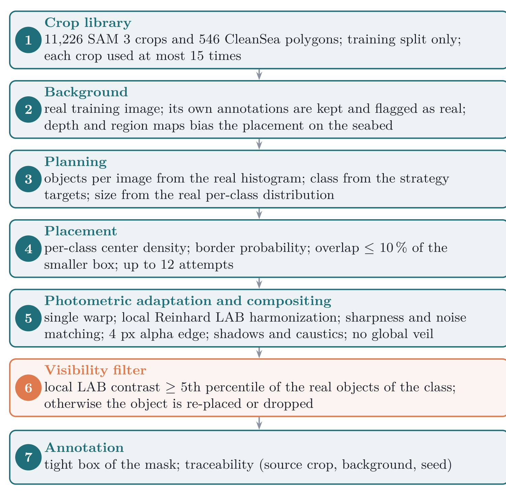
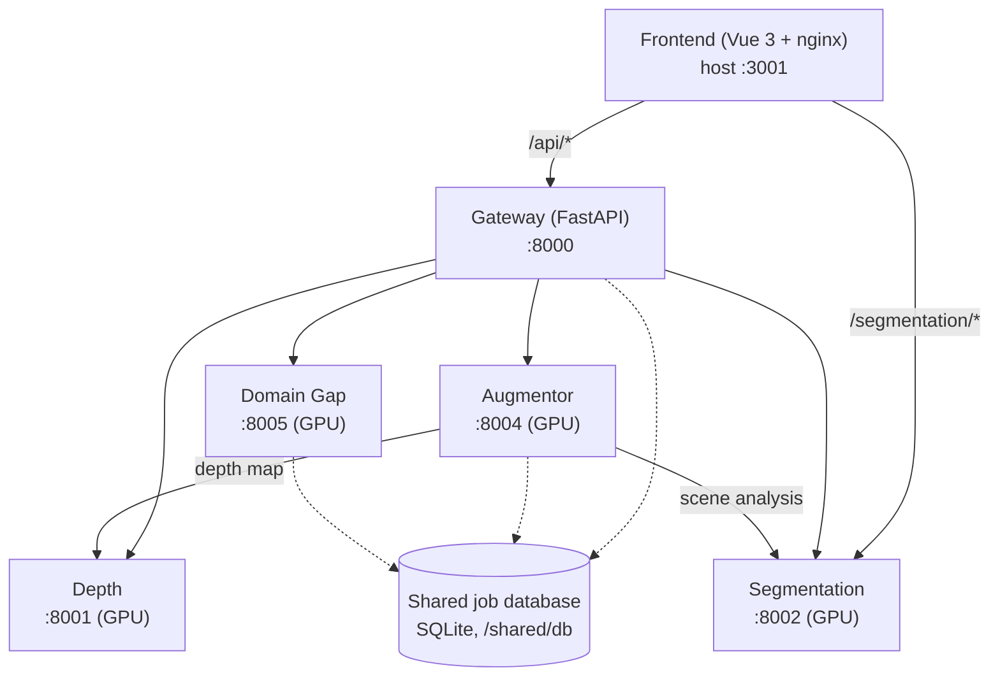
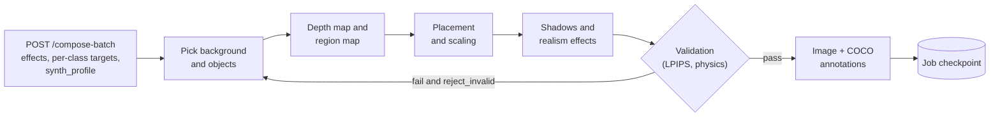
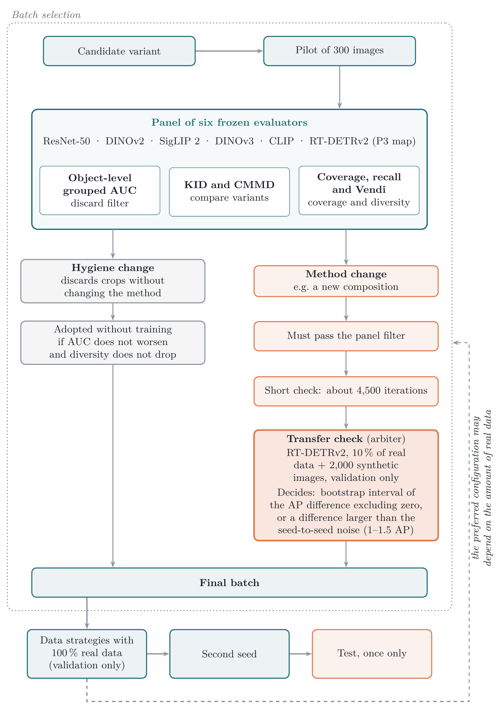
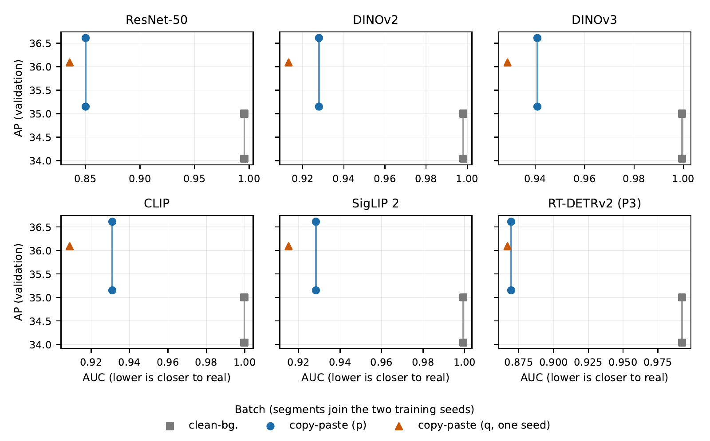

# Synthetic Dataset Generator

Generator of synthetic object-detection datasets by copy-paste composition with depth-aware placement, physically
motivated effects and automatic quality validation. It is organised as a set of FastAPI microservices behind a
gateway, with a Vue web interface. The built-in domain presets cover underwater scenes (used for marine debris
detection), fire and smoke, and aerial scenes; new domains are added with a JSON file.

The generator was developed for the marine debris detection work of the OceanguardAI project and produced the
synthetic batch used in the thesis experiments. The configuration of that batch is documented in
[`docs/SYNTHESIS_PROFILE.md`](docs/SYNTHESIS_PROFILE.md).

The copy-paste configuration used for underwater debris detection follows these stages:



## Features

- Depth-aware composition: object scale, blur and occlusion follow a monocular depth map (Depth Anything 3).
- Scene understanding with text-prompted segmentation (SAM 3) and a heuristic fallback.
- Object extraction from annotated datasets into RGBA crop libraries.
- Realism effects: colour matching, blur matching, underwater tint, caustics, multi-light shadows, edge smoothing,
  Poisson blending.
- Synthesis profiles (`legacy`, `v10`, `v11`): class-faithful scale and count, placement from real position
  statistics, copy-paste onto real backgrounds, visibility filter, background matching, tight boxes.
- Quality validation with LPIPS, physics consistency checks and anomaly detection; invalid images can be rejected.
- Domain-gap tools: FID/KID metrics, domain randomization, depth-aware style transfer (WCT), diffusion refinement, and
  automatic tuning of the effect parameters.
- Dataset utilities: combine, split (percentage or K-fold), balance and export to COCO, YOLO and Pascal VOC.

## Architecture



The gateway is the single entry point of the web interface. The augmentor calls the depth and segmentation services
directly, and the gateway, augmentor and domain-gap services share a SQLite job database so that interrupted jobs
can be resumed.

| Service | Port | GPU | Role |
|---|---|---|---|
| Gateway | 8000 | no | API orchestration, routing, domain registry |
| Depth | 8001 | yes | Depth Anything 3 inference |
| Segmentation | 8002 | yes | SAM 3 scene analysis and object extraction |
| Augmentor | 8004 | yes | Composition, effects, placement and validation |
| Domain Gap | 8005 | yes | Metrics, style transfer, diffusion, auto-tune |
| Frontend | 3001 | no | Web interface |

See [`ARCHITECTURE.md`](ARCHITECTURE.md) for the design, [`docs/USER_GUIDE.md`](docs/USER_GUIDE.md) for the
web workflow and [`docs/ML_AUTO_TUNING.md`](docs/ML_AUTO_TUNING.md) for the auto-tuning module.

## Requirements

- Docker with the NVIDIA Container Toolkit.
- An NVIDIA GPU (CUDA 12.8 images; developed on an RTX 5090) with at least 8 GB of VRAM.
- 16 GB of RAM (32 GB recommended).
- A Hugging Face token with access to the gated `facebook/sam3` model.

## Installation

```bash
git clone https://github.com/asferrer/synthetic-dataset-generator.git
cd synthetic-dataset-generator

cp .env.microservices.example .env
# Edit .env: DATASET_PATH (folder with Backgrounds_filtered/ and the crop libraries) and HF_TOKEN

docker compose -f docker-compose.microservices.yml up -d --build
curl http://localhost:8000/health
```

Open <http://localhost:3001>. `.env` holds the Hugging Face token and is git-ignored; never commit it.

## Usage

The web interface follows four steps: prepare sources, configure effects and placement, generate, and export
(combine, split, balance, convert format). Batches can also be launched through the API:

```bash
curl -X POST http://localhost:8004/compose-batch -H "Content-Type: application/json" \
     -d @configs/batch_request.json
```

`configs/batch_request.json` holds the effects, per-class targets and validation settings of the thesis batch; add
`"synth_profile": "v11"` (and optional `synth_overrides`) to enable a synthesis profile.

Endpoint reference: the OpenAPI documentation of each service at `http://localhost:<port>/docs`.

Flow of a batch job in the augmentor (details in [`ARCHITECTURE.md`](ARCHITECTURE.md), section 2):



### Domains

Domains are defined in `config/domains/` (`underwater.json`, `fire_smoke.json`, `aerial_birds.json`; start from
`_template.json` for a new one) and validated against `domain_schema.json`. A domain sets regions, object classes,
physics, effects, presets and domain-gap profiles.

## How batches are selected

The article chooses the configuration of the batch with a panel of frozen evaluators (object-level grouped AUC, KID,
CMMD, coverage, recall and Vendi score) as a filter and a short transfer check on a detector as the final arbiter.



*Figure from the accompanying article.*

The figure below plots, for each evaluator of the panel, the validation AP of the training arms against the AUC of
their synthetic batch (lower AUC means closer to real).



*Figure from the accompanying article.*

## Reproducing the synthetic batch of the thesis

[`docs/SYNTHESIS_PROFILE.md`](docs/SYNTHESIS_PROFILE.md) lists the inputs, the statistics scripts, the crop library
filter (`tools/clean_crops.py`) and the commands that generate the batch with `tools/run_variants.py`.

## Repository layout

```
services/        gateway, depth, segmentation, augmentor, domain_gap and shared job utilities
frontend-vue/    Vue 3 + Tailwind web interface
config/          domain definitions, object size priors
configs/         service configuration and the batch request used in the thesis
scripts/         statistics and descriptor builders, test helpers
tools/           crop-library cleaning, mask refinement, box refit, variant runner
tests/           unit, integration (Docker) and end-to-end tests
docs/            user guide, auto-tuning, synthesis profiles, references
```

## Tests

```bash
pip install -r requirements-dev.txt torch==2.6.0 torchvision==0.21.0 lpips
cd services/augmentor && python -m pytest tests -q        # profile, placement and composition logic; no GPU
cd ../.. && python -m pytest tests/unit -q                # crop-library cleaning and mask refinement
cd services/domain_gap && python -m pytest tests -q       # schemas of the domain-gap service
```

Integration and end-to-end tests (`tests/integration`, `tests/e2e`) need the Docker stack running.

## Third-party models and licenses

Model weights are not distributed with this repository; each service downloads them from the original source under
its own license. See [`NOTICE`](NOTICE) for the list (SAM 3, Depth Anything 3, Stable Diffusion, ControlNet,
IP-Adapter, LPIPS). Depth Anything 3 Large and Giant are CC BY-NC 4.0; the default Base model is Apache-2.0.
The key references are collected in [`docs/references.bib`](docs/references.bib).

## Citation

If you use this code, please cite the article (metadata also in [`CITATION.cff`](CITATION.cff)):

```bibtex
@article{sanchezferrer2026synthetic,
  title   = {When Does Synthetic Data Help Underwater Debris Detection? Gap Metrics, Data Regimes and Detector Paradigms},
  author  = {S{\'a}nchez-Ferrer, Alejandro and Gallego, Antonio Javier and Calvo-Zaragoza, Jorge},
  journal = {Neurocomputing},
  year    = {2026},
  note    = {Manuscript in preparation}
}
```

## License

Apache License 2.0. See [`LICENSE`](LICENSE).
